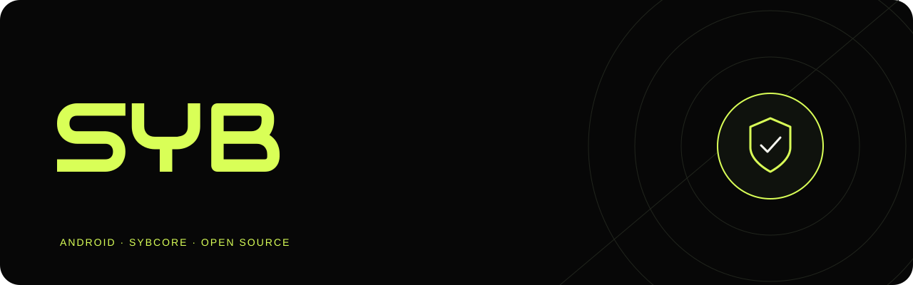

**Быстрый и аккуратный клиент для Android на ядре SYBcore.**

## Возможности

- **Протоколы** - VLESS, VMess, Trojan, Shadowsocks, Hysteria2, WireGuard, REALITY, XHTTP.
- **Подписки** - ссылка, QR-код, файл или буфер обмена; обновление по расписанию.
- **SYBping** - нажмите на цифры у сервера, чтобы перемерить.
- **Маршруты** - правила по доменам, IP и приложениям; выбор приложений, которые идут через туннель.
- **Защита** - блокировка рекламы и трекеров, контроль IPv6 и STUN.
- **Удобство** - виджеты, плитка в шторке, автозапуск, обновления прямо из приложения.

Языки: русский, English, Español, 简体中文.

## Установка

Скачайте APK из [последнего релиза](https://github.com/Semazz/SYB-Android/releases/latest):

| Файл | Для чего |
|---|---|
| `…-arm64-v8a.apk` | Почти все современные телефоны |
| `…-armeabi-v7a.apk` | Старые 32-битные устройства |
| `…-x86_64.apk` | Эмуляторы |

SYB не продаёт и не раздаёт серверы - нужна собственная подписка или конфигурация. Ключи и ссылки подписок хранятся зашифрованными (Android Keystore).

## Лицензии

SYB - [GPL-3.0](LICENSE). [Xray-core](https://github.com/XTLS/Xray-core) - MPL-2.0, флаги - [flag-icons](https://github.com/lipis/flag-icons) (MIT), отрисовка SVG - [AndroidSVG](https://bigbadaboom.github.io/androidsvg/) (Apache-2.0). Тексты лицензий - в [docs/licenses](docs/licenses).

Сообщая о проблеме, укажите версию, модель телефона и протокол. Не публикуйте ссылки подписок, UUID и ключи.

